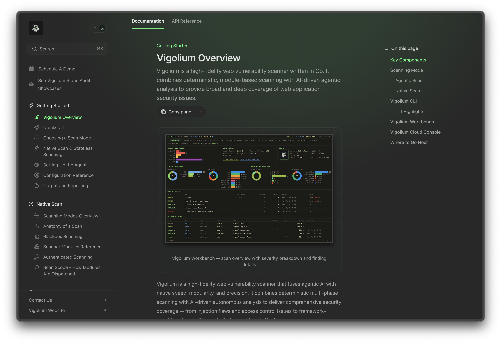

# Vigolium documentation

This repository contains the public documentation site for Vigolium, built with Mintlify.

Vigolium is a high-fidelity web vulnerability scanner written in Go. It combines deterministic, module-based scanning with AI-driven agentic analysis to help teams find web application security issues across native scans, source-aware audits, and autonomous engagements.



## Gimorra — An autonomous offensive-security agent

**Gimorra** is the autonomous offensive-security platform within Vigolium — *hunts while you sleep*. Pointed at an **authorized** target with a goal and a scope, it runs recon → scan → propose PoC → deterministically prove → report, with a human in the loop only where blast radius requires one. Vigolium is the scan engine underneath it.

Autonomy is bought with deterministic guardrails, not with a human gating every action: a non-destructive **deterministic validator** re-proves every finding (the agent proposes, code disposes), **auto-cleanup and a kill switch** bound what a run can leave behind, and a deny-wins **scope guard** is evaluated per tool call. None of the three depends on the model, so a prompt-injected agent does not get past them.

> Gimorra only operates against targets you are authorized to test. No authorization artifact, no active operation — enforced in code, not policy.

## Links

| Resource | URL |
| --- | --- |
| Website | [https://www.vigolium.com/](https://www.vigolium.com/) |
| Documentation | [https://docs.vigolium.com/](https://docs.vigolium.com/) |
| Gimorra | [https://gimorra.vigolium.com/](https://gimorra.vigolium.com/) |
| Demo showcases | [https://demo.vigolium.com/showcases](https://demo.vigolium.com/showcases) |

## What is covered

- Getting started with Vigolium and choosing a scan mode
- Native scanning, scanner modules, authentication, and scan scope
- Agentic scanning with autopilot, swarm, Vigolium Audit, Piolium, and Olium
- Gimorra, the autonomous offensive-security agent built on top of the engine
- Server mode, ingestion, API references, reporting, and customization

## Local development

Install the Mintlify CLI:

```bash
npm i -g mint
```

Preview the documentation:

```bash
mint dev
```

Check links:

```bash
mint broken-links
```
