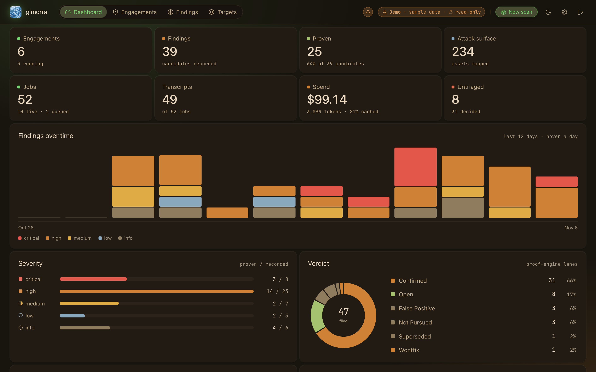
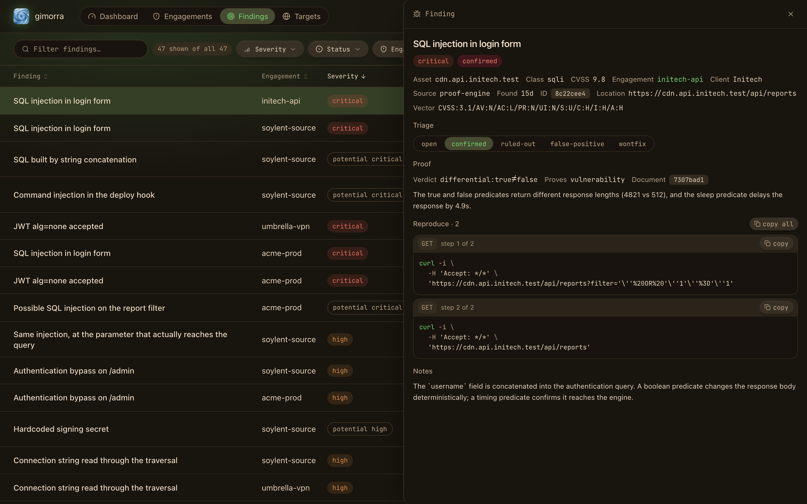
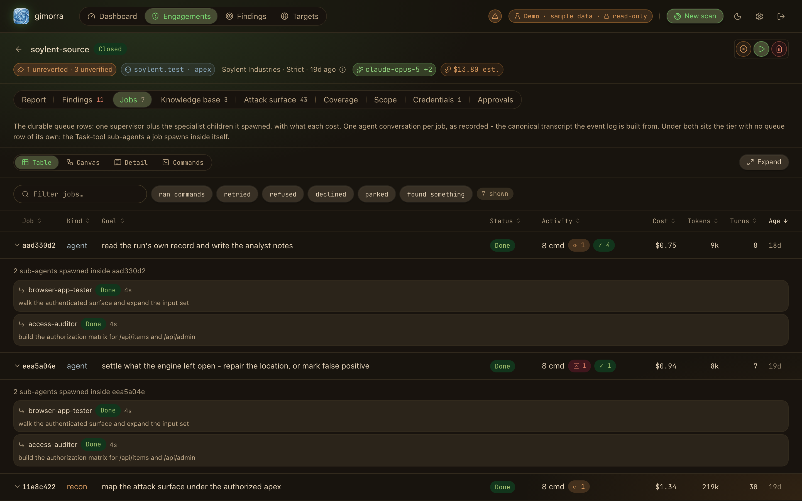
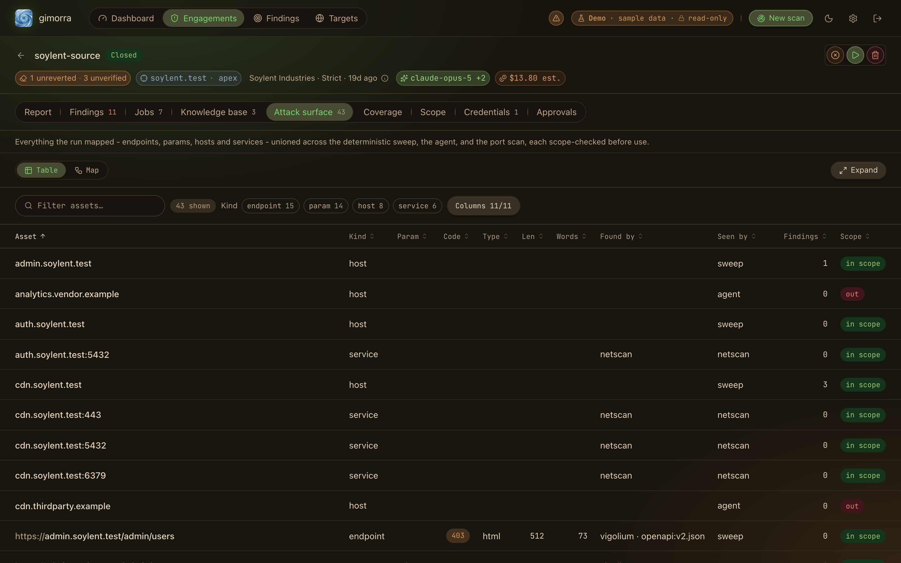
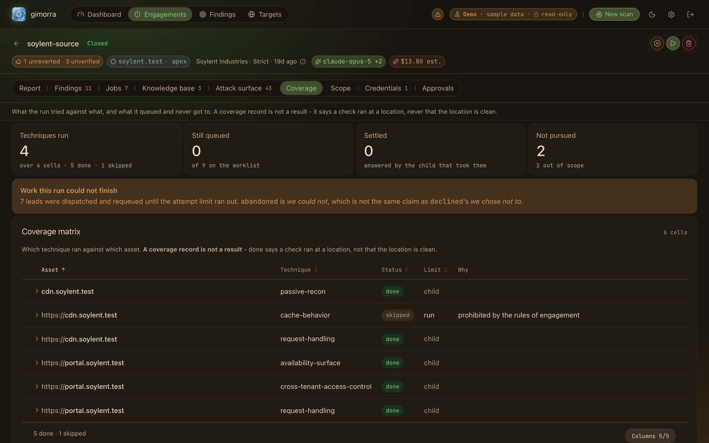
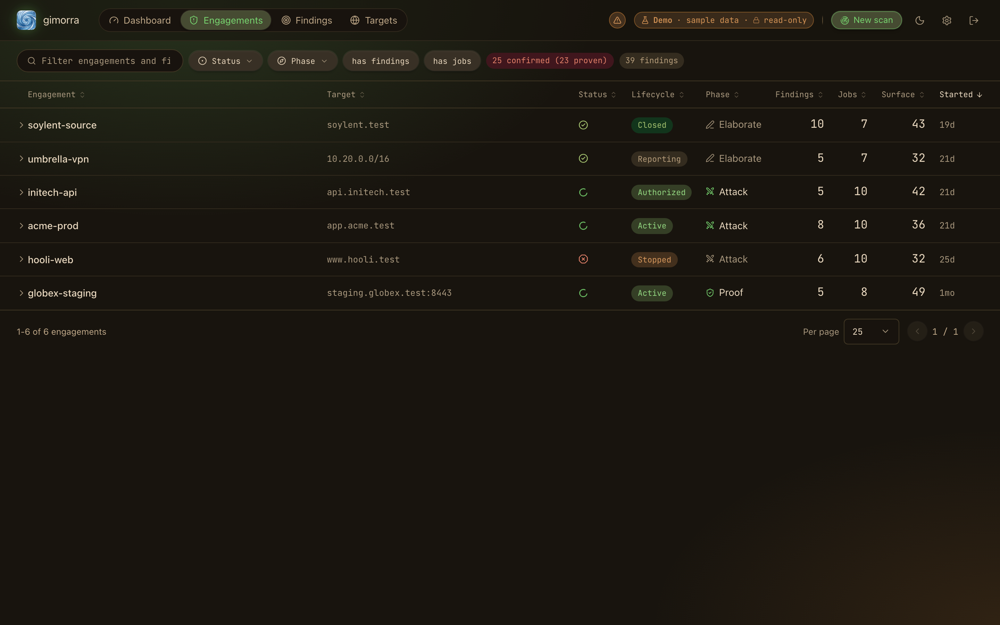

Gimorra arms your model with agents, attack skills, validators and an evidence trail, then pushes it to its ceiling: planning the attack, chaining bugs, re-proving every finding and writing the report. Point it at a target and walk away.

<Frame caption="The Gimorra console. Every engagement, every finding, every dollar spent, on one screen.">
  
</Frame>

<Callout icon="rocket" color="#FFC107" iconType="regular">
  Click through a finished run in the [demo console](https://gimorra-demo.vigolium.com/). It is read-only and needs no login. Want Gimorra on your own target? Email [jessie@vigolium.com](mailto:jessie@vigolium.com), [request a demo](https://www.vigolium.com/request-demo), or visit [gimorra.vigolium.com](https://gimorra.vigolium.com/). Already invited? Jump to [Installation](/gimorra/installation).
</Callout>

## Features

<Columns cols={2}>
  <Card title="Every ounce out of your model" icon="brain">
    A supervisor splits the work across specialist agents armed with attack skills. A second model reviews the plan and calls out what it missed.
  </Card>
  <Card title="Any starting point" icon="crosshairs">
    A URL, an IP range, a domain, a repo, an app bundle, an API spec or a whole bug-bounty scope document. One command takes all of them.
  </Card>
  <Card title="Brief it in plain English" icon="comment">
    `-p "focus on IDOR and broken access control"` and the run aims there. `--dry-run` shows which words set which flag.
  </Card>
  <Card title="Re-proved, not guessed" icon="circle-check">
    Deterministic code with no AI in it re-tests every candidate. An agent can never mark its own finding confirmed.
  </Card>
  <Card title="Chains bugs, chases impact" icon="link">
    Gimorra combines findings into larger attacks, then follows a confirmed bug to see what else it hands an attacker.
  </Card>
  <Card title="Hunts what scanners miss" icon="magnifying-glass">
    The hypothesis phase assumes a critical bug exists and goes looking for it, long after an ordinary pass would give up.
  </Card>
  <Card title="Logged in like a real user" icon="user-lock">
    Hand it accounts and it logs in as each one before the attack. Access-control bugs between users are fair game.
  </Card>
  <Card title="Source and live, together" icon="code">
    Pass `--source` and the run audits the code while it attacks the app. Every agent can read the source.
  </Card>
  <Card title="Evidence you can replay" icon="fingerprint">
    A hash-chained trail ties each finding to the exact request and response that proved it, with copy-paste `curl` steps.
  </Card>
  <Card title="Memory between runs" icon="layer-group">
    The next engagement starts from what the last one learned: pages, endpoints, working techniques and held accounts.
  </Card>
  <Card title="Bring your own model" icon="microchip">
    A Claude login, an Anthropic key, a proxy or any OpenAI-compatible endpoint. Route the supervisor and the children to different models.
  </Card>
  <Card title="Built for CI and long runs" icon="gauge-high">
    `--exit-on-findings` fails the build. `--detach` survives a closed terminal. `--resume` picks up where a run stopped, without paying twice.
  </Card>
</Columns>

## Inside the console

Everything a run does lands in the console, live while it runs and frozen when it finishes. These screenshots come straight from the [demo console](https://gimorra-demo.vigolium.com/).

<Columns cols={2}>
  <Frame caption="Engagement report: proven versus recorded, by severity and by class">
    
  </Frame>
  <Frame caption="Finding detail: the proof verdict and the requests that reproduce it">
    
  </Frame>
  <Frame caption="Agent jobs: the supervisor, its specialists, and what each one cost">
    
  </Frame>
  <Frame caption="Attack surface: every host, service, endpoint and parameter, scope-checked">
    
  </Frame>
  <Frame caption="Coverage: which technique ran where, and what the run never answered">
    
  </Frame>
  <Frame caption="Engagements: every run, its phase, findings and surface at a glance">
    
  </Frame>
</Columns>

## What a run does

One command runs a whole engagement through a fixed order of phases. The console prints one line per phase, marked with its symbol.

<Frame caption="One run from start to finish. A brief becomes a plan, recon maps the target, the agents propose candidates, and the proof engine drops every candidate it cannot prove.">
  
</Frame>

<Steps>
  <Step title="⌥ Resolve, ◎ target and ◈ scope">
    Your plain-English brief becomes flags, and Gimorra shows which words produced each one. It authorizes the target and locks the scope. From here on, the scope guard checks every tool call against it.
  </Step>
  <Step title="⊙ Crawl">
    Vigolium crawls the target and runs a DAST pass at native speed, no model involved. It hands the agents leads, not findings.
  </Step>
  <Step title="⌖ Observe">
    The agent takes a short, passive first look: what the target is, what it runs, and what deserves a closer look.
  </Step>
  <Step title="⋆ Ideate">
    The agent ranks what is most likely broken on this target, with a reason for each. No requests, no findings, just a plan of attack.
  </Step>
  <Step title="❖ Attack">
    A supervisor splits the work across specialist child agents, one lead each. A cheaper model reviews the plan and flags what it misses. The scope guard checks every call.
  </Step>
  <Step title="⊢ Proof">
    Deterministic code, with no AI in it, re-tests every candidate. Only what this proof engine confirms becomes a finding.
  </Step>
  <Step title="Closing phases">
    The run keeps digging after the first proof pass:

    - **⊔ Salvage** recovers results from child agents that stopped before they wrote them.
    - **≟ Hypothesis** assumes a high or critical bug exists and hunts for it.
    - **⊨ Triage** settles what the proof engine left open: repair the candidate or mark it a false positive.
    - **⋈ Compose** chains findings into a larger attack.
    - **⊩ Exploit** follows one confirmed finding to see what else it gives an attacker.

    Everything these phases produce goes back through the proof engine.
  </Step>
  <Step title="✎ Elaborate, ⊕ surface and ≡ done">
    Gimorra writes the analyst notes, lists every page and endpoint it found, and saves the run in one folder: findings, evidence trail, agent transcripts and the report.
  </Step>
</Steps>

Some phases switch on when you give the run their input:

| Phase | Runs when |
|---|---|
| **⎆ Login** | You pass accounts with `--account` or `--auth-file`. The run logs in as each account before the attack. |
| **▤ Audit** | You pass the target's source with `--source`. The run audits the code, and every agent can read it. |
| **⍟ OSINT** | You ask for host discovery with `--recon deep` or `gimorra recon`. The run sweeps the whole domain for hosts first. |
| **⊞ Netscan** | You pass `--netscan`. The run hunts for open network services. |

Turn off a default phase with `--skip <phase>`, for example `--skip hypothesis`. [Running a scan](/gimorra/running-a-scan) covers the rest of the flags.

## Safety controls in code

Gimorra doesn't ask you to click "approve" on every action. Its guardrails live in code, so you set the level of supervision once per run and let it work.

<Columns cols={3}>
  <Card title="The proof engine decides" icon="circle-check">
    Agents propose, deterministic code disposes. Each candidate is re-tested with the least invasive request that settles the question.
  </Card>
  <Card title="Cleanup and a kill switch" icon="power-off">
    A run undoes the changes it makes to the target. One command ends the engagement: no agent picks up queued work, and the proof engine accepts nothing more.
  </Card>
  <Card title="Scope guard on every tool call" icon="shield-halved">
    Every tool call that touches the target is checked against the scope before it runs. A deny rule beats any allow rule.
  </Card>
</Columns>

None of the three depends on the model, the agent or the network stack. A prompt injection that hijacks the model can't switch them off.

<Warning>
  Gimorra works only against targets you are authorized to test. Without an authorization record, the code refuses to start any active testing.
</Warning>

## What you can give it

| Input | Result |
|---|---|
| A URL, host, domain, IP or CIDR | A scoped, authorized engagement that maps the target, tests it, and proves the real bugs |
| A sentence of plain English | The same engagement, aimed where you asked, for example *"focus on IDOR and broken access control"* |
| An API spec or a captured session | Every documented operation becomes a test target before the first request goes out |
| A repository or a shipped app bundle | A source-code audit, alongside the live target or on its own |
| A bug-bounty scope document | One engagement that covers every in-scope asset |

`--intensity` sets how hard the run hits, from `passive` to `aggressive`. Nothing else needs tuning to get a first result.

## Vigolium or Gimorra

<Columns cols={2}>
  <Card title="Vigolium · Free and open source" icon="terminal" href="/getting-started/quickstart">
    **The best DAST CLI on the market.**

    Free, open source, and fast enough to gate every build. Native scans for breadth, agentic scans for depth, and every finding ships with the request that proves it.

    - 215+ scanner modules in one binary
    - Native speed on every push, agentic depth before every release
    - Runs on your own infrastructure, in your own CI
  </Card>
  <Card title="Gimorra · Proprietary, by request" icon="bolt" href="mailto:jessie@vigolium.com">
    **Gimorra unlocks the full power.**

    Vigolium is the engine. Gimorra is the whole red team. It arms your model with agents, attack skills, validators and an evidence trail, then pushes it to its ceiling: planning the attack, chaining bugs, re-proving every finding and writing the report. Point it at a target and walk away.

    - Squeezes every ounce of intelligence out of the model you bring
    - Any starting point: URL, IP range, repo or app bundle
    - Every candidate re-proved before it counts as confirmed
  </Card>
</Columns>

| | What it is | Use it when |
|---|---|---|
| [**Native scan**](/native-scan/how-it-works) | Deterministic scanning with modules | You want broad, repeatable coverage, fast |
| [**Agentic scan**](/agentic-scan/how-it-works) | AI inside a scan that you drive | You want AI judgement on a run you control |
| **Gimorra** | An agent that runs the whole engagement | You want the engagement done, start to finish |

<Note>
  Gimorra runs its tools on the machine where you start it, so anything a tool does happens on that machine. Run it in a container. An all-in-one image is available for this.
</Note>

## Next steps

<Columns cols={3}>
  <Card title="Installation" icon="download" href="/gimorra/installation">
    Get your invite, install the CLI and the Vigolium engine, and check the host.
  </Card>
  <Card title="LLM configuration" icon="microchip" href="/gimorra/llm-configuration">
    Plug in the model that drives the agents: a Claude login, an API key or your own endpoint.
  </Card>
  <Card title="Running a scan" icon="play" href="/gimorra/running-a-scan">
    Targets, briefs, intensity, budgets, scope and where the results land.
  </Card>
</Columns>

---

See what Gimorra finds before you commit: open the [demo console](https://gimorra-demo.vigolium.com/), then email [jessie@vigolium.com](mailto:jessie@vigolium.com) to put it on your own target.
