Gimorra is the autonomous offensive-security agent in Vigolium. You give it a target you are authorized to test, a goal and a scope. It maps the target, attacks it, proves each finding with deterministic code, and writes the report. It uses Vigolium as its scan engine.

<Frame caption="One run from start to finish. A brief becomes a plan, recon maps the target, the agent proposes candidates, and the validator drops every candidate it cannot prove.">
  
</Frame>

<Callout icon="rocket" color="#FFC107" iconType="regular">
  To see a finished run, open the [demo console](https://gimorra-demo.vigolium.com/). It is read-only, needs no login, and holds one engagement exactly as a real run left it. To try Gimorra on your own target, [request a demo](https://www.vigolium.com/request-demo), email [jessie@vigolium.com](mailto:jessie@vigolium.com), or visit [gimorra.vigolium.com](https://gimorra.vigolium.com/). If you already have access, start with [Installation](/gimorra/installation).
</Callout>

## What a run does

A scan is one engagement that moves through a fixed order of phases. The console prints one line per phase, marked with the phase's symbol. A plain `gimorra scan <target>` goes through these phases:

<Steps>
  <Step title="⌥ Resolve, ◎ target and ◈ scope">
    Gimorra turns your plain-English brief into flags, and shows which words produced each flag. It then authorizes the target and sets the scope. For the rest of the run, the scope guard checks tool calls against this scope.
  </Step>
  <Step title="⊙ Crawl">
    Vigolium crawls the target and runs a DAST pass without using the model. This takes minutes on a real target. It produces leads for the agent, not proven findings.
  </Step>
  <Step title="⌖ Observe">
    The agent takes a short, passive first look at the target. It writes down what the target is, what software it runs, and what deserves a closer look.
  </Step>
  <Step title="⋆ Ideate">
    The agent lists what is most likely wrong with this target, ranked, with a reason for each. It sends no requests to the target, and it records no findings.
  </Step>
  <Step title="❖ Attack">
    A supervisor agent splits the work between specialist child agents. Each child works one lead, and the scope guard checks every tool call it makes. A cheaper model reviews the supervisor's plan and points out what it misses. The supervisor can ignore that advice.
  </Step>
  <Step title="⊢ Proof">
    Deterministic code, with no AI in it, re-tests every candidate the agents propose. A candidate becomes a finding only if this proof engine confirms it.
  </Step>
  <Step title="Closing phases">
    These phases run after the proof engine:

    - **⊔ Salvage** recovers results from child agents that stopped before they wrote them.
    - **≟ Hypothesis** assumes a high or critical bug exists and searches for it.
    - **⊨ Triage** decides the candidates the proof engine left open. It repairs a candidate or marks it a false positive.
    - **⋈ Compose** looks for findings that combine into a larger attack.
    - **⊩ Exploit** follows one confirmed finding to see what else it gives an attacker.

    Every candidate these phases produce goes through the proof engine.
  </Step>
  <Step title="✎ Elaborate, ⊕ surface and ≡ done">
    Gimorra writes the analyst notes, lists every page and endpoint it found, and saves the run in one folder. The folder holds the findings, the evidence trail, the agent transcripts and the report.
  </Step>
</Steps>

Some phases run only when you give the run their input:

| Phase | Runs when |
|---|---|
| **⎆ Login** | You pass accounts with `--account` or `--auth-file`. The run logs in as each account before the attack. |
| **▤ Audit** | You pass the target's source with `--source`. The run audits the code, and every agent can read it. |
| **⍟ OSINT** | You ask for host discovery with `--recon deep` or `gimorra recon`. The run searches the whole domain for hosts before testing. |
| **⊞ Netscan** | You pass `--netscan`. The run looks for open network services. |

To turn off a default phase, pass `--skip <phase>`, for example `--skip hypothesis`. [Running a scan](/gimorra/running-a-scan) covers the other flags that change a run.

## Safety controls in code

Many offensive-security agents ask a person to approve each action. Gimorra instead enforces three safety controls in code, so you set the level of supervision once per run.

<Columns cols={3}>
  <Card title="The proof engine decides" icon="circle-check">
    The agent proposes findings, and deterministic code without AI re-tests each one. It uses the least invasive request that settles the question. An agent cannot mark its own finding as confirmed.
  </Card>
  <Card title="Cleanup and a kill switch" icon="power-off">
    A run undoes the changes it makes to the target. One command ends the engagement: no agent can pick up queued work, and the proof engine accepts no more results.
  </Card>
  <Card title="Scope guard on every tool call" icon="shield-halved">
    The guard checks every tool call that touches the target against the scope before the call runs. A deny rule overrides any allow rule.
  </Card>
</Columns>

None of the three controls depends on the model, the agent or the network stack. A prompt injection that takes over the model does not turn them off.

<Warning>
  Gimorra works only against targets you are authorized to test. Without an authorization record, the code refuses to start any active testing.
</Warning>

## What you can give it

| Input | Result |
|---|---|
| A URL, host, domain, IP or CIDR | A scoped and authorized engagement that maps the target, tests it, and proves the real bugs |
| A sentence of plain English | The same engagement, focused where you asked, for example *"focus on IDOR and broken access control"* |
| An API spec or a captured session | Every documented operation becomes a test target before the run sends any request |
| A repository or a shipped app bundle | A source-code audit, together with the live target or on its own |
| A bug-bounty scope document | One engagement that covers every in-scope asset |

The `--intensity` flag sets how hard the run tests, from `passive` to `aggressive`. You don't need to change any other setting to get a first result.

## What you get back

<Columns cols={2}>
  <Card title="Only proven findings" icon="flask">
    Deterministic code reproduced every finding in the report. The report contains no unconfirmed guesses for you to triage.
  </Card>
  <Card title="An evidence trail" icon="link">
    A hash-chained log links each finding to the exact request and response that proved it.
  </Card>
  <Card title="A report you can share" icon="file-lines">
    The report lists confirmed findings only, in Markdown or HTML. A live dashboard shows the run while it is going.
  </Card>
  <Card title="Memory between runs" icon="layer-group">
    Later engagements reuse what earlier ones learned: the pages and endpoints they found, the techniques that worked, and the accounts they held.
  </Card>
</Columns>

## How it compares to other Vigolium modes

| | What it is | Use it when |
|---|---|---|
| [**Native scan**](/native-scan/how-it-works) | Deterministic scanning with modules | You want broad, repeatable coverage that runs fast |
| [**Agentic scan**](/agentic-scan/how-it-works) | AI inside a scan that you drive | You want AI judgement on a run you control |
| **Gimorra** | An agent that runs the whole engagement | You want the engagement done from start to finish |

<Note>
  Gimorra runs its tools on the machine where you start it, so anything a tool does happens on that machine. Run it in a container. An all-in-one image is available for this.
</Note>

## Next steps

<Columns cols={3}>
  <Card title="Installation" icon="download" href="/gimorra/installation">
    Get access, install the CLI and the Vigolium engine, and check that the host is ready.
  </Card>
  <Card title="LLM configuration" icon="microchip" href="/gimorra/llm-configuration">
    Choose the model that drives the agent: a Claude login, an API key or your own endpoint.
  </Card>
  <Card title="Running a scan" icon="play" href="/gimorra/running-a-scan">
    Targets, briefs, intensity, budgets, scope and where the results go.
  </Card>
</Columns>

---

To see what Gimorra finds on your own target, look at the [demo console](https://gimorra-demo.vigolium.com/) first. Then [request a demo](https://www.vigolium.com/request-demo) or email [jessie@vigolium.com](mailto:jessie@vigolium.com).
