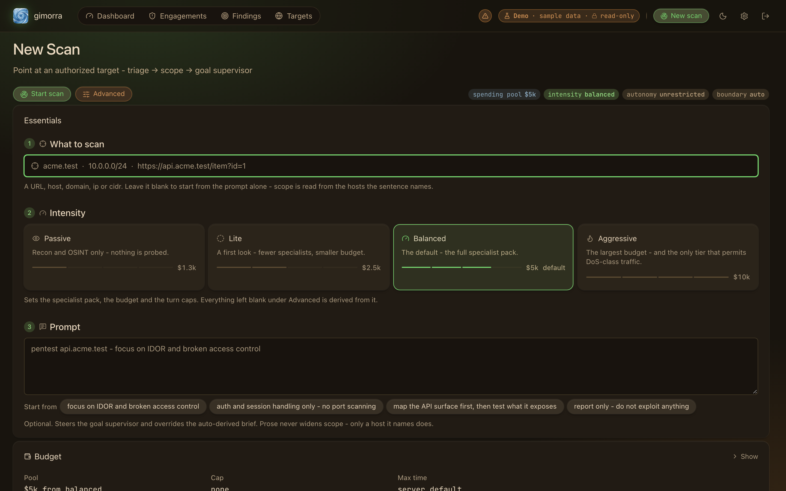
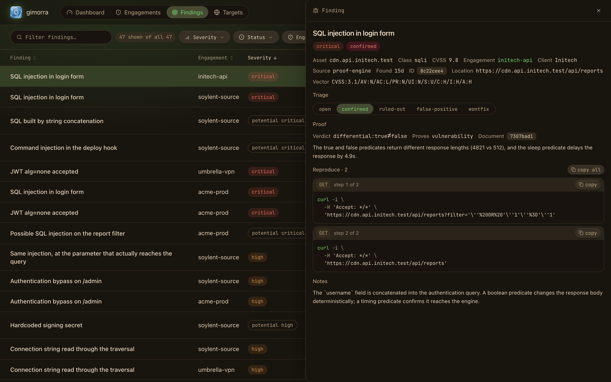
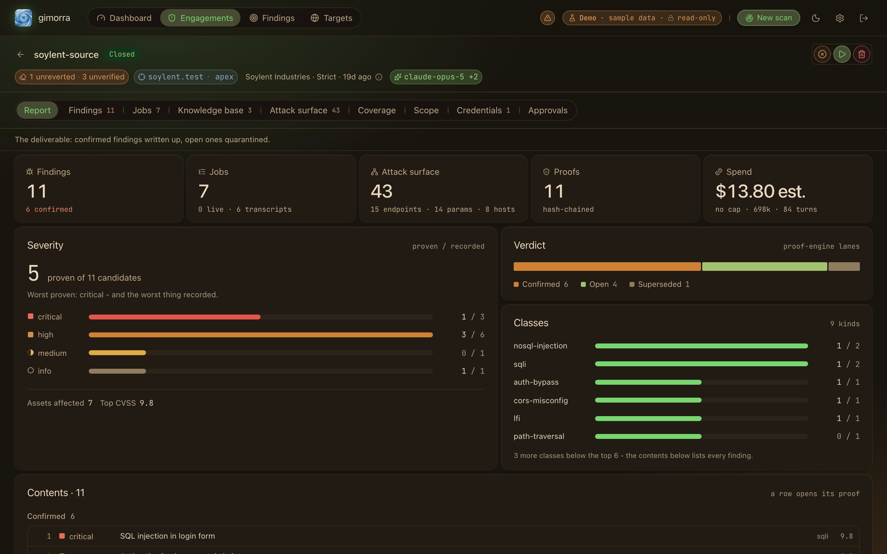

## Your first scan

```bash
gimorra scan -t https://app.example.com
```

That's it. One command runs the whole engagement: Gimorra authorizes the target you typed, locks the scope, maps and attacks the target, proves what it finds, and writes the report. The console prints a line as each phase starts. [What a run does](/gimorra#what-a-run-does) describes each phase.

`scan` is the default command. Every command takes `-h` to print its flags and examples, and `gimorra help scan --groups` lists the scan flags by topic.

Rather click than type? The console's **New scan** page builds the same run from a target, an intensity and a brief.

<Frame caption="New scan in the console: a target, an intensity and a plain-English brief">
  
</Frame>

## Targets

| Target | Example |
|---|---|
| A URL | `gimorra scan -t https://app.example.com` |
| A host, domain, IP or CIDR | `gimorra scan -t example.com`, `gimorra scan -t 10.0.0.0/28` |
| A list of targets | `gimorra scan -T targets.txt`, with one target per line |
| An API spec | `gimorra scan -t https://api.example.com --spec openapi.json` |
| A live app and its source code | `gimorra scan -t https://staging.example.com --source ./repo` |
| Source code alone | `gimorra audit ./repo` |

## Describe the scan in plain English

Pass a brief with `-p` to tell the run where to focus. Gimorra sets flags from your words and gives the brief to the agents as instructions:

```bash
gimorra scan -t https://app.example.com -p "focus on IDOR and broken access control"
```

Add `--dry-run` to see which flags the brief set, and which words set each one, without starting a run:

```bash
gimorra scan -t https://app.example.com -p "be gentle, 2 requests per second" --dry-run
```

## Intensity

`--intensity` sets how hard the run tests. Each level also sets the default spend limit per engagement:

| Intensity | Default spend limit | What it runs |
|---|---|---|
| `passive` | $25 | Discovery and spidering only. No DAST pass. |
| `lite` | $60 | A smaller active test, with a slower crawl. |
| `balanced` | $150 | The default. The full non-destructive assessment. |
| `aggressive` | $400 | Everything in `balanced`, plus the most intrusive DAST phase. This is the only level that allows denial-of-service checks. |

```bash
gimorra scan -t https://app.example.com --intensity lite
```

## Budgets and limits

| Flag | What it limits |
|---|---|
| `--spend-cap-usd <usd>` | The total spend per engagement. The run stops at this amount. |
| `-b, --budget-usd <usd>` | The money available to the child agents. The default is half of the intensity's spend limit. |
| `--max-duration <time>` | The total run time, as `2h`, `90m` or a number of seconds. At the limit, the run stops its work and writes the report from what it has. |

```bash
gimorra scan -t https://app.example.com --spend-cap-usd 40 --max-duration 2h
```

A run that stopped at a limit, on Ctrl-C or after a crash can continue. `--resume` restarts it from where it stopped, and you don't pay again for finished work:

```bash
gimorra scan -t https://app.example.com --resume
```

## Scope and rules of engagement

Before a tool call reaches the target, the scope guard checks it against the scope. A deny rule overrides any allow rule.

| Flag | What it does |
|---|---|
| `--scope <level>` | Sets how far past your typed targets the run can go: `typed`, `direct`, `apex` (the default) or `related`. With `typed`, the run tests only the targets you wrote. |
| `--deny <target>` | Keeps a host, wildcard, IP or CIDR in the program, but blocks every request to it. You can pass it more than once. |
| `--max-rps <n>` | Sets the maximum requests per second to any one host. |
| `--header '<Name: value>'` | Adds a header to every request, for example a bug-bounty program's researcher header. |
| `--autonomy <tier>` | Sets the approval tier: `unrestricted` (the default, with no approval steps), `standard` or `strict`. Use a stricter tier when you don't own the target or the budget. |

```bash
gimorra scan -t example.com --deny legacy.example.com --max-rps 5 --header 'X-Bug-Bounty: yourhandle'
```

## Test as a logged-in user

If you give the run an account, it logs in before the attack, and every agent can act as that user. The simplest way is to put the account in the brief:

```bash
gimorra scan -t https://app.example.com -p "test it logged in, username: qa@example.com password: <password>"
```

You can also pass accounts with `--account`. The command takes a reference to the secret, such as an environment variable, never the secret itself:

```bash
export ALICE_SID=...
gimorra scan -t https://app.example.com --account alice:acme:admin=cookie:sid:env:ALICE_SID
```

## Find hosts before you scan

By default, Gimorra scans a domain you type as a single target. To find the hosts in a domain first, run `gimorra recon`. It finds and ranks the hosts, and scans none of them. Then scan the ranked hosts, best first:

```bash
gimorra recon -t example.com
gimorra scan -t example.com --roster board
```

`--recon deep` does both in one run.

## Run in the background

`--detach` passes the scan to a background daemon and returns right away. The run keeps going after you close the terminal, and a shell with a time limit doesn't stop it:

```bash
gimorra scan -t https://app.example.com --detach
gimorra queue                 # lists queued, running and stopped runs
gimorra queue cancel <id>     # stops a run
gimorra queue resume <id>     # restarts a stopped run
```

## Read the results

```bash
gimorra eng list                     # lists every engagement with its full id
gimorra eng brief <id>               # shows confirmed findings, open leads and file locations
gimorra findings report <id>         # writes the engagement report
gimorra findings chain <id>          # verifies the hash-chained evidence trail
```

To copy the results and the full HTML report into a directory you choose:

```bash
gimorra scan -t https://app.example.com --output ./out --report-html ./out/report.html
```

`gimorra serve` starts the local console, which shows runs live while they are going. Every finding opens to its proof verdict and the exact requests that reproduce it:

<Columns cols={2}>
  <Frame caption="A finding with its proof and reproduction steps">
    
  </Frame>
  <Frame caption="The engagement report: proven versus recorded">
    
  </Frame>
</Columns>

## Stop a run

`gimorra eng kill` ends an engagement immediately. It stops new requests to the target, and the proof engine rejects any result that arrives after it:

```bash
gimorra eng kill <id>
```

## Use it in CI

With `--exit-on-findings`, the scan exits with code `3` when it finds anything actionable, so a CI pipeline can fail on it:

```bash
gimorra scan -t https://staging.example.com --intensity lite --exit-on-findings
```

## Drive it from a coding agent

The `gimorra` binary includes its own manual as agent skills. A coding agent can read the manual for the installed version instead of guessing at flags:

```bash
gimorra skills get gimorra-scanner                                  # the CLI, recipes and a list of references
gimorra skills get gimorra-scanner --file references/scanning.md   # the full `gimorra scan` reference
gimorra skills install -g                                           # installs the skills into ~/.claude/skills/
```
